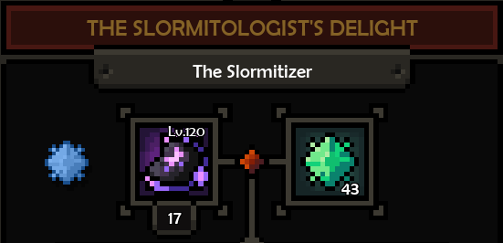
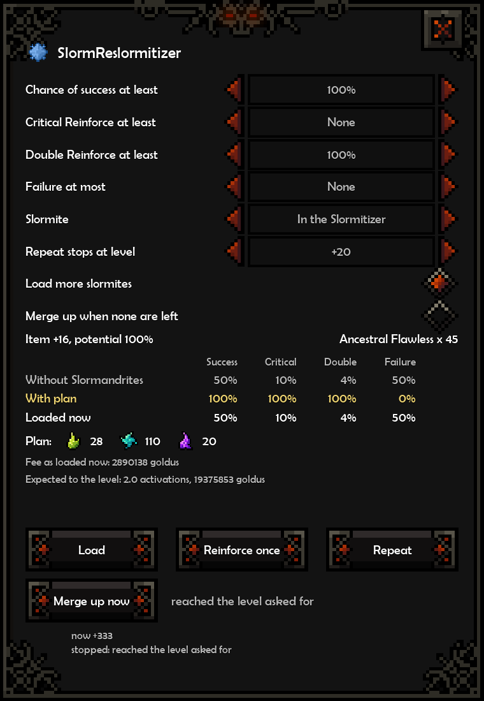

# SlormReslormitizer

Reinforces your equipment at Rick Manalan's Slormitizer in [The Slormancer](https://store.steampowered.com/app/1104280/The_Slormancer/). On [Nexus Mods](https://www.nexusmods.com/theslormancer/mods/16).

Click the slormite left of the Slormitizer's item slot and set the level you want. The mod loads the cheapest Slormandrites to get there and reinforces, once or until the item reaches that level.





- Plans the whole reinforcement, counting goldus, Slormandrites and slormites.
- Optional floors on the odds of every reinforce.
- Loads more slormites when they run out, and can merge lower ones up.
- Never activates unless the game's odds match the plan.

## Requirements

- The Slormancer on Steam (Windows, 64-bit).
- [SlormAPI](https://github.com/tsotsas/SlormAPI/releases) 1.0.0 or later.
- The Microsoft Visual C++ 2015-2022 Redistributable (x64).

## Install

1. Back up your save: `%LocalAppData%\The_Slormancer`
2. Install SlormAPI with its installer, if you have not yet.
3. Download the latest `SlormReslormitizer` zip from [Releases](https://github.com/wistb/SlormMods/releases) or [Nexus Mods](https://www.nexusmods.com/theslormancer/mods/16), and extract it into the game folder, so `SlormReslormitizer.dll` lands in `mods\Aurie`.

## Uninstall

Delete `mods\Aurie\SlormReslormitizer.dll`.

## Build

Needs Windows with VS 2022 Build Tools (C++ workload), run from WSL.

```
./build.sh          # bin/SlormReslormitizer.dll
./build.sh deploy   # also copy into the game's mods/Aurie (set SLORM_GAME, or put it in the .env at the top of the repo)
./build.sh play     # deploy, then start the game through Steam
./build.sh package  # dist/SlormReslormitizer-v<version>.zip
```

`SLORM_DEV=1` builds the dev variant, which logs the game's Slormitizer calls and samples its odds on F10. The optimizer's checks build with g++: `make -C mods/SlormReslormitizer/tests test`.

Built on [Aurie](https://github.com/AurieFramework/Aurie), [YYToolkit](https://github.com/AurieFramework/YYToolkit) and [SlormAPI](https://github.com/tsotsas/SlormAPI); see [THIRD-PARTY.md](../../THIRD-PARTY.md). Licensed under AGPL-3.0.
